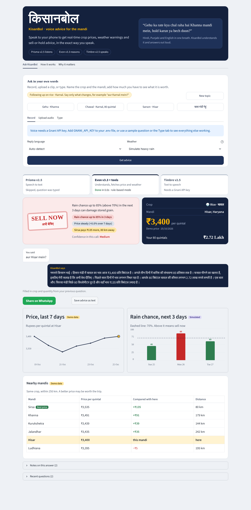
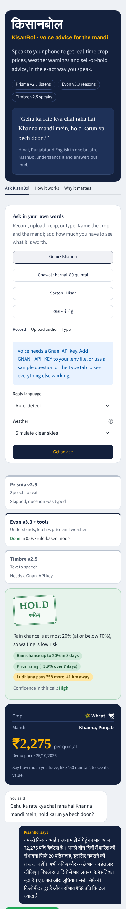
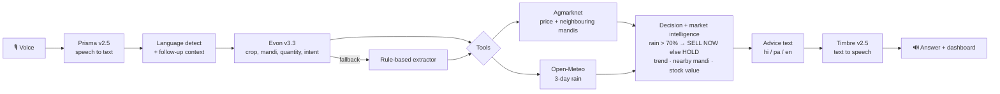

# 🌾 KisanBol (किसानबोल)

> **Speak to your phone to get real-time crop prices, weather warnings, and actionable market advice, in the exact way you speak.**

Built for **The Great Indian AI Internship Challenge** by Gnani AI. A voice-in, voice-out sell-or-hold advisor for smallholder farmers and traders, on **Gnani Prisma v2.5** (speech to text), **Gnani Evon v3.3** (reasoning) and **Gnani Timbre v2.5** (text to speech).

| Sell now, with a follow-up | Phone layout |
|---|---|
|  |  |

## The problem

A farmer in Khanna doesn't type formal English. He says *"Gehu ka rate kya chal raha hai Khanna mandi mein, hold karun ya bech doon?"*: Hindi, Punjabi and English in one breath. Generic assistants fail on that, and the decision (sell today or wait) can swing a season's income.

## Features

| | |
|---|---|
| **Voice in, voice out** | Record or upload (up to 60 s) → Prisma → decision → Timbre speaks the answer |
| **Sell-or-hold decision** | Rain chance above 70% in the next 3 days = **SELL NOW**, otherwise **HOLD**. Threshold is configurable. Shows a confidence level |
| **Value of your stock** | Say "80 quintal" and see ₹2.72 Lakh; the spoken reply says "2.72 लाख रुपये" |
| **7-day price trend** | Line chart plus a spoken line on whether the price is rising or falling |
| **Nearby mandi comparison** | Same crop within 250 km, price gap and distance, and a spoken tip when a nearby mandi pays 2% or more |
| **Follow-ups** | "aur Karnal mein?" keeps the crop and quantity from your previous question |
| **Asks back** | If the crop or mandi is missing, it asks a short question in the farmer's language |
| **Reply language** | Hindi, Punjabi or English, auto-detected from how you spoke |
| **Honest data labels** | Every price, trend and forecast is marked Live, Simulated or Demo |
| **Share** | WhatsApp share link and a text download |
| **REST API** | `api.py` reuses the same engine for phone lines (IVR), WhatsApp bots or mobile apps |
| **Mobile-first UI** | Mandi-board design, works down to phone width |

## Architecture



**Principles**
- **Every external call degrades gracefully.** No live price → labelled demo price. No forecast → no sell/hold call (never a guess). Evon unavailable → rule-based extraction. Timbre unavailable → text answer.
- **Facts come from code, not the model.** The decision rule and every number are computed in Python; Evon may only rephrase, and its output is rejected if it drops a verified fact.
- **One core, many channels.** `kisanbol_engine.py` serves the Streamlit app and the REST API.

## Project structure

```
kisanbol_engine.py   pipeline: Prisma STT → Evon + tools → decision → Timbre TTS
market_intel.py      7-day trend, nearby-mandi comparison, distances
indic.py             language detection, quantities, Lakh/Crore formatting
app.py               Streamlit interface
ui_style.py          visual system (CSS)
api.py               optional REST channel (FastAPI)
test_engine.py       18 offline tests
.streamlit/config.toml · Dockerfile · .env.example
```

## Quick start

```bash
python -m venv venv && source venv/bin/activate     # Windows: venv\Scripts\activate
pip install -r requirements.txt
streamlit run app.py
```

It runs with **no keys**: use the sample questions or the Type tab, and switch **Weather** to *Simulate heavy rain* or *Simulate clear skies* to show both verdicts. For voice, copy `.env.example` to `.env` and add `GNANI_API_KEY`.

```bash
pytest -q                                            # offline tests
pip install -r requirements-api.txt && uvicorn api:app --port 8000   # REST API
docker build -t kisanbol . && docker run -p 8501:8501 --env-file .env kisanbol
```

### Configuration (`.env`)

| Variable | Purpose |
|---|---|
| `GNANI_API_KEY` | Prisma + Timbre. Without it: no voice in or out |
| `EVON_BASE_URL` | Optional. OpenAI-compatible server hosting Evon v3.3 (open weights) |
| `DATA_GOV_IN_API_KEY` | Optional. Live Agmarknet prices. Without it: labelled demo prices |
| `RAIN_THRESHOLD` | Default 70 |
| `ENABLE_TTS_TAGS` | `true` sends `<reassuring>` / `<pause>` to Timbre. Off by default until confirmed with your key |

## API

`POST /ask` (multipart: `audio` file **or** `text`; optional `language`, `weather_scenario`, `speak`) returns the transcript, entities, price, weather, verdict, insights, advice text and base64 audio. `GET /health` reports which services are configured.

## Honest limitations

- **Evon v3.3 is open-weight, not on Gnani's hosted API.** Without `EVON_BASE_URL`, the app uses rule-based extraction (the UI says so).
- **Prisma and Timbre response formats are partly assumed** from Gnani's public docs and SDKs. Run one real voice question to confirm; errors show what the service returned.
- **Live Agmarknet needs a free data.gov.in key.** The resource ID may need adjusting. The 7-day trend is demo data unless several days of live records are returned.
- **Demo data is deterministic and labelled.** It is for showing the flow, never real prices.
- Fonts (Martel, Mukta) load from Google Fonts and need an internet connection; the layout falls back gracefully.
- Decision support, not financial advice.

## Roadmap

Phone-line (IVR) and WhatsApp voice notes via the API · Minimum Support Price comparison · storage and freight-aware advice · more languages (Marathi, Telugu, Gujarati, Bhojpuri) · price alerts.

## Acknowledgements

Gnani AI (Prisma, Evon, Timbre) · Agmarknet / data.gov.in · Open-Meteo · The Great Indian AI Internship Challenge

## License

MIT

## What changed in this version

- **The whole page changes with the language.** Pick English, हिन्दी or ਪੰਜਾਬੀ at the top: every label, the verdict, the answer, charts, notes and errors are translated, and the last answer is redrawn in the new language.
- **Audio and video upload works.** Upload wav, mp3, m4a, mp4, webm, ogg, aac, flac, 3gp, mov and more (up to 25 MB / 60 s). The audio is extracted and converted automatically (needs `imageio-ffmpeg`, installed by `requirements.txt`, or a system ffmpeg).
- **No model names or workflow in the interface.** Technical detail stays in this README and the code.
- **Voice without a key (optional):** `pip install -r requirements-offline-voice.txt` enables offline recognition on your computer. Not tested in the build sandbox (model download was blocked), so try it once on your machine.
- Tests: `python -m pytest -q` (35 offline tests, including real audio/video conversion).
