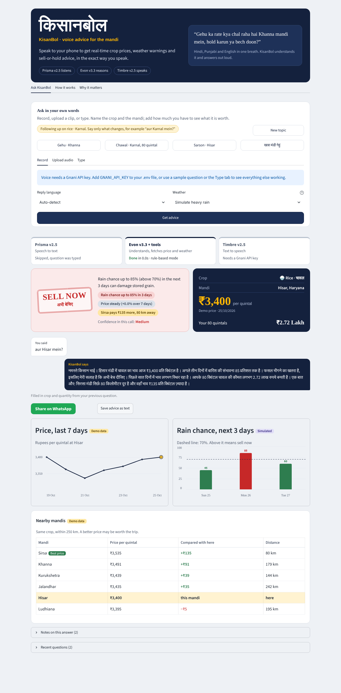
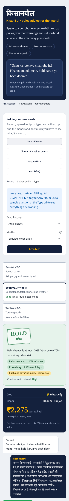
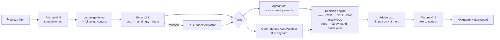

# 🌾 KisanBol — किसानबोल

> **Voice-in, voice-out sell-or-hold advisor for smallholder farmers.**  
> Ask in Hindi, Punjabi, or English (or mix all three) — get today's mandi price, a 3-day rain warning, and one clear answer.


| Sell now + follow-up | Mobile layout |
|---|---|
|  |  |

---

## Table of Contents

1. [The Problem](#the-problem)
2. [Features](#features)
3. [How It Works](#how-it-works)
4. [Project Structure](#project-structure)
5. [Quick Start](#quick-start)
6. [Configuration](#configuration)
7. [Supported Languages](#supported-languages)
8. [REST API](#rest-api)
9. [Running Tests](#running-tests)
10. [Docker](#docker)
11. [Honest Limitations](#honest-limitations)
12. [Roadmap](#roadmap)
13. [Acknowledgements](#acknowledgements)
14. [License](#license)

---

## The Problem

A farmer in Khanna doesn't type formal English. He says:

> *"Gehu ka rate kya chal raha hai Khanna mandi mein, hold karun ya bech doon?"*

Hindi, Punjabi and English in one breath. Generic assistants fail on that. And the sell-or-hold decision can swing a season's income. KisanBol is built for exactly this.

---

## Features

| Feature | Description |
|---|---|
| **Voice in, voice out** | Record or upload audio/video (up to 60 s) → speech-to-text → decision → spoken answer |
| **Sell-or-hold verdict** | Rain probability ≥ 70% in the next 3 days → **SELL NOW**, otherwise **HOLD**. Threshold is configurable. Shows a confidence level |
| **Stock value calculator** | Say "80 quintal" and see ₹2.72 Lakh; the spoken reply says "2.72 लाख रुपये" |
| **7-day price trend** | Line chart plus a spoken line on whether the price is rising or falling |
| **Nearby mandi comparison** | Same crop within 250 km — price gap, distance, and a tip when a nearby mandi pays 2%+ more |
| **Follow-up questions** | "aur Karnal mein?" keeps the crop and quantity from your previous question |
| **Clarification** | If crop or mandi is missing, asks a short question in the farmer's own language |
| **10 languages** | English, Hindi, Punjabi, Marathi, Gujarati, Bengali, Tamil, Telugu, Kannada, Malayalam |
| **Honest data labels** | Every price, trend and forecast is marked **Live**, **Simulated** or **Demo** |
| **GPS location** | Tap the pin → nearest covered mandi auto-detected (opt-in, never stored) |
| **Day window control** | Choose 1, 3 or 7 days for price history and rain forecast |
| **Share** | WhatsApp share link and plain-text download |
| **Farm assistant** | Chat panel for follow-up farming questions (storage, seeds, fertilizer, pests, loans, insurance) |
| **REST API** | `api.py` exposes the same engine for IVR phone lines, WhatsApp bots, or mobile apps |
| **Mobile-first UI** | Mandi-board design, works down to phone screen width |

---

## How It Works



**Design principles**

- **Every external call degrades gracefully.** No live price → labelled demo price. No forecast → no sell/hold call (never a guess). Evon unavailable → rule-based extraction. Timbre unavailable → text answer.
- **Facts come from code, not the model.** The decision rule and every number are computed in Python; the LLM may only rephrase, and its output is rejected if it drops a verified fact.
- **One core, many channels.** `kisanbol_engine.py` serves the Streamlit app and the REST API without any duplication.

---

## Project Structure

```
kisanbol_streamlit/
│
├── app.py                  # Streamlit front end (all UI, tabs, charts, chat)
├── kisanbol_engine.py      # Core pipeline: STT → entity extraction → tools → decision → TTS
├── market_intel.py         # 7-day trend, nearby-mandi comparison, haversine distances
├── indic.py                # Language detection, quantity parsing, Lakh/Crore formatting
├── i18n.py                 # All UI strings in English, Hindi, Punjabi (+ helpers)
├── advisor.py              # Farm assistant: farming Q&A with no hallucinated numbers
├── audio_utils.py          # Audio/video conversion and format detection (uses imageio-ffmpeg)
├── ui_style.py             # CSS visual system (mandi-board theme)
├── api.py                  # Optional FastAPI REST channel
├── check_locale.py         # Locale consistency checker
│
├── locales/                # Per-language string files (mr, gu, bn, ta, te, kn, ml)
│   ├── __init__.py
│   ├── bn.py               # Bengali
│   ├── gu.py               # Gujarati
│   ├── kn.py               # Kannada
│   ├── ml.py               # Malayalam
│   ├── mr.py               # Marathi
│   ├── ta.py               # Tamil
│   └── te.py               # Telugu
│
├── docs/                   # Screenshots for this README
│
├── test_engine.py          # Core pipeline tests (offline, no API keys needed)
├── test_advisor.py         # Farm assistant tests
├── test_audio_i18n.py      # Audio conversion + i18n tests
├── test_horizon.py         # Day-window / horizon tests
├── test_location_days.py   # GPS location and day-range tests
├── conftest.py             # Shared pytest fixtures
│
├── .streamlit/
│   └── config.toml         # Streamlit theme config
├── requirements.txt        # Core dependencies
├── requirements-api.txt    # Extra deps for the REST API
├── requirements-offline-voice.txt  # Offline speech recognition (optional)
├── Dockerfile
├── .env.example            # Template — copy to .env and add keys
└── README.md
```

---

## Quick Start

```bash
# 1. Clone and create a virtual environment
git clone <repo-url>
cd kisanbol_streamlit

python -m venv venv
# Linux / macOS
source venv/bin/activate
# Windows
venv\Scripts\activate

# 2. Install dependencies
pip install -r requirements.txt

# 3. (Optional) Add API keys
cp .env.example .env
# Edit .env and add GNANI_API_KEY, DATA_GOV_IN_API_KEY, etc.

# 4. Run
streamlit run app.py
```

The app runs **with no keys at all**: use the sample question buttons or the Type tab. Switch the **Weather** demo toggle to *Simulate heavy rain* or *Simulate clear skies* to see both verdicts without any external calls.

---

## Configuration

Copy `.env.example` to `.env` and set the variables you need:

| Variable | Required | Purpose |
|---|---|---|
| `GNANI_API_KEY` | Optional | Enables voice input (Prisma STT) and voice output (Timbre TTS). Without it, only text mode works |
| `GNANI_STT_KEY` | Optional | Override for speech-to-text only (falls back to `GNANI_API_KEY`) |
| `GNANI_TTS_KEY` | Optional | Override for text-to-speech only (falls back to `GNANI_API_KEY`) |
| `EVON_BASE_URL` | Optional | OpenAI-compatible server running Evon v3.3 (open weights). Without it, rule-based extraction is used |
| `EVON_MODEL` | Optional | Model name (default: `gnani/gnani-evon-v3.3-30B-A3B`) |
| `DATA_GOV_IN_API_KEY` | Optional | Live Agmarknet prices from data.gov.in. Without it, labelled demo prices are shown |
| `ACCUWEATHER_API_KEY` | Optional | AccuWeather 5-day forecast. Falls back to Open-Meteo (free, 3-day) if not set |
| `RAIN_THRESHOLD` | Optional | Rain probability % that triggers SELL NOW (default: `70`) |
| `LOCATION_MAX_KM` | Optional | How far a GPS location can be from a covered mandi before the app asks for the mandi name (default: `150`) |
| `ENABLE_TTS_TAGS` | Optional | Send `<reassuring>` / `<pause>` SSML tags to Timbre. Off by default until confirmed with your key (`true`/`false`) |
| `HTTP_TIMEOUT` | Optional | Seconds before an external call times out (default: `30`) |
| `CACHE_TTL_SECONDS` | Optional | How long prices are cached (default: `600`) |

---

## Supported Languages

The full UI (labels, verdict, charts, notes, errors) and the farm assistant are available in 10 languages:

| Code | Language | Script |
|---|---|---|
| `en-IN` | English | Latin |
| `hi-IN` | Hindi | Devanagari |
| `pa-IN` | Punjabi | Gurmukhi |
| `mr-IN` | Marathi | Devanagari |
| `gu-IN` | Gujarati | Gujarati |
| `bn-IN` | Bengali | Bengali |
| `ta-IN` | Tamil | Tamil |
| `te-IN` | Telugu | Telugu |
| `kn-IN` | Kannada | Kannada |
| `ml-IN` | Malayalam | Malayalam |

To add a new language, copy any file from `locales/` and run:

```bash
python check_locale.py <language-code>
```

---

## REST API

Start the API server (requires `requirements-api.txt`):

```bash
pip install -r requirements-api.txt
uvicorn api:app --port 8000
```

**`POST /ask`** — multipart form

| Field | Type | Description |
|---|---|---|
| `audio` | file | Audio file (WAV, MP3, M4A, …) — use this **or** `text` |
| `text` | string | Plain-text question — use this **or** `audio` |
| `language` | string | Optional. e.g. `hi-IN`. Defaults to auto-detect |
| `weather_scenario` | string | Optional. `rainy` or `clear` for demo/testing |
| `speak` | bool | Optional. Return base64 TTS audio in the response |
| `lat` / `lon` | float | Optional. GPS coordinates for nearest-mandi lookup |

Response JSON includes: `transcript`, `entities`, `price`, `weather`, `verdict`, `insights`, `advice_text`, `audio` (base64, if `speak=true`).

**`GET /health`** — reports which services are configured (STT, TTS, Evon, Agmarknet, AccuWeather).

---

## Running Tests

```bash
# All offline tests (no API keys needed)
pytest -q

# Specific test files
pytest test_engine.py -v
pytest test_advisor.py -v
pytest test_audio_i18n.py -v
pytest test_horizon.py -v
pytest test_location_days.py -v
```

The test suite has 35+ offline tests covering the pipeline, farm assistant, audio conversion, day-window logic, and GPS location handling.

---

## Docker

```bash
# Build
docker build -t kisanbol .

# Run (pass your .env file)
docker run -p 8501:8501 --env-file .env kisanbol
```

Open `http://localhost:8501` in your browser.

---

## Honest Limitations

- **Evon v3.3 is open-weight, not on Gnani's hosted API.** Without `EVON_BASE_URL`, the app uses rule-based entity extraction (the UI clearly says so).
- **Prisma and Timbre response formats are partly inferred** from Gnani's public docs and SDKs. Run one real voice question to confirm the exact format your key returns.
- **Live Agmarknet requires a free data.gov.in key.** The resource ID may need adjusting for your account. The 7-day trend shows as demo data unless multiple days of live records come back.
- **AccuWeather's standard plan gives 5 days.** A question about 12 days is answered with 5 days available, and the answer says so. Without the key, Open-Meteo (3-day, free) is used.
- **Demo data is deterministic and labelled.** It exists to show the workflow, never real prices.
- **GPS only works on HTTPS** (Streamlit Cloud is; local `http://localhost` is not). The browser also requires an explicit user tap.
- **Fonts (Martel, Mukta) load from Google Fonts** — need an internet connection. The layout degrades gracefully without them.
- **This is decision support, not financial advice.**

---

## Roadmap

- IVR phone-line channel via the REST API
- WhatsApp voice-note integration
- Minimum Support Price (MSP) comparison
- Storage and freight-cost-aware advice
- More mandis (currently 11 in Punjab and Haryana)
- Price alerts (push notifications)
- Offline voice recognition (experimental, see `requirements-offline-voice.txt`)

---

## Acknowledgements

- [Gnani AI](https://gnani.ai) — Prisma STT, Evon LLM, Timbre TTS
- [Agmarknet](https://agmarknet.gov.in) / [data.gov.in](https://data.gov.in) — commodity price data
- [Open-Meteo](https://open-meteo.com) — free weather forecast API
- [AccuWeather](https://developer.accuweather.com) — extended forecast (optional)
- The Great Indian AI Internship Challenge by Gnani AI

---

## License

[MIT](LICENSE) — free to use, modify and distribute.

---

## Changelog

### Latest version

- **Whole-page language switching.** Pick English, हिन्दी or ਪੰਜਾਬੀ (or 7 more) at the top — every label, verdict, chart, note and error redraws in the new language. The last answer is also redrawn.
- **Audio and video upload.** WAV, MP3, M4A, MP4, WebM, OGG, AAC, FLAC, 3GP, MOV and more (up to 25 MB / 60 s). Audio is extracted and converted automatically via `imageio-ffmpeg` (no system ffmpeg required).
- **GPS nearest-mandi.** Tap the pin icon, allow location, and the app finds the nearest covered mandi and says which one and how far.
- **Configurable day window.** Select 1, 3 or 7 days for the price history and rain forecast panels. A number in the question ("in 5 days") overrides the selector.
- **Farm assistant.** A chat panel answers farming questions (storage, rain protection, seeds, fertiliser, pests, loans, insurance) in the selected language. Grounded in live result data; never invents doses or subsidy figures.
- **10-language support.** Marathi, Gujarati, Bengali, Tamil, Telugu, Kannada and Malayalam added via the `locales/` system.
- **No model names in the UI.** Technical details stay in this README and the code.
- 35+ offline tests (up from 18).
